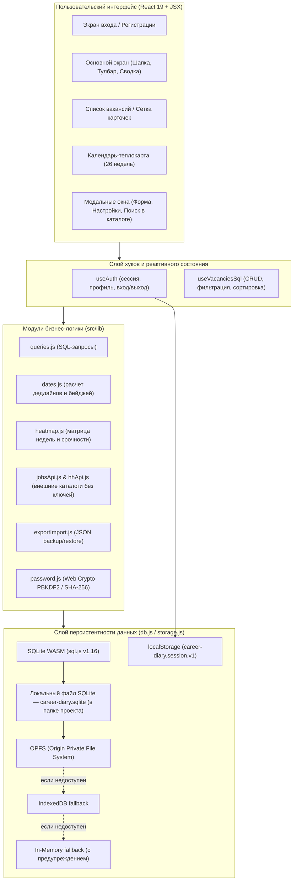
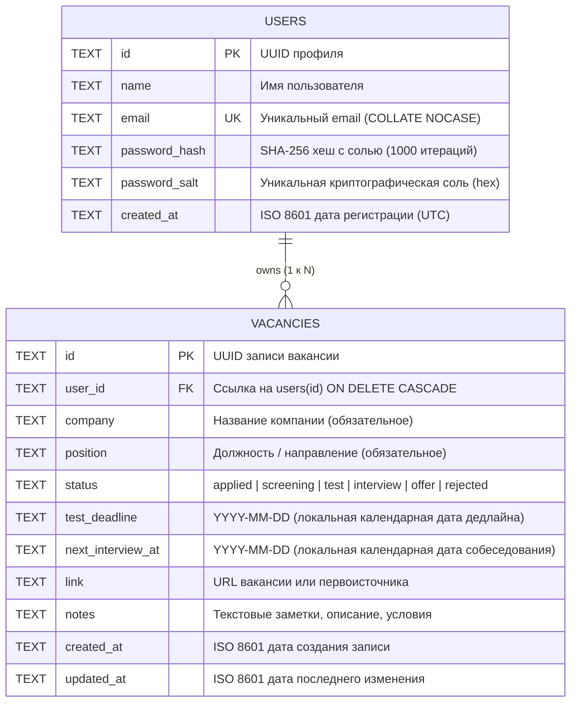
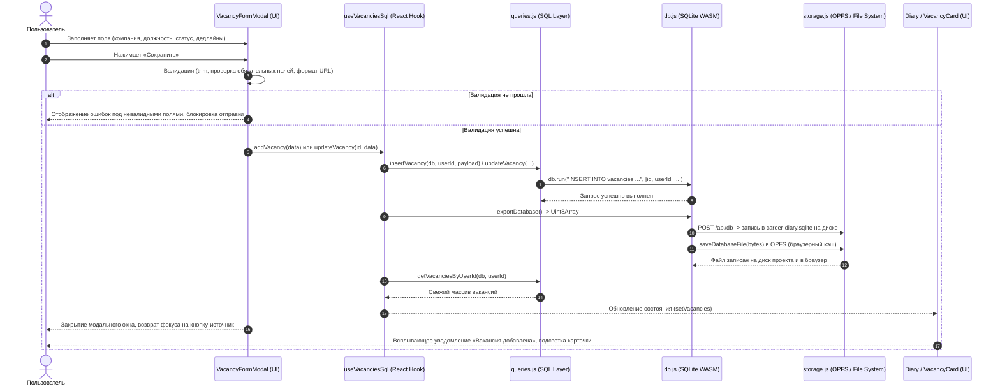

# Архитектура проекта «Карьерный дневник» (ARCHITECTURE.md)

Документ описывает техническое устройство приложения, схему и связи данных, жизненный цикл пользовательских действий, уровни хранения и зафиксированные ограничения реализации в соответствии с требованиями итоговой сдачи ИДЗ № 1.

---

## 1. Общее устройство системы

Приложение представляет собой локальное одностраничное веб-приложение (Single Page Application, SPA) без внешнего бэкенда и облачной базы данных. Все вычисления, рендеринг, хранение и управление состоянием выполняются непосредственно в браузере пользователя.

---

## 2. Сущности, поля и связи данных

Данные хранятся в реляционной базе данных SQLite (движок WebAssembly `sql.js`). Схема поддерживает строгую ссылочную целостность (`FOREIGN KEY ... ON DELETE CASCADE`), индексы для быстрой фильтрации и версионирование через `PRAGMA user_version = 2`.

### Назначение полей и обоснование решений:
1. **Изоляция данных (`user_id`):** каждый профиль видит только свои вакансии. Все выборки `SELECT`, добавления `INSERT`, обновления и подсчеты счетчиков фильтруются по `WHERE user_id = ?`.
2. **Даты в формате `YYYY-MM-DD`:** локальная календарная дата без временной компоненты и часовых поясов. Гарантирует, что перевод часов или сдвиг часового пояса не смещает дедлайн. Лексикографический порядок строк `YYYY-MM-DD` строго совпадает с хронологическим, что позволяет эффективно использовать стандартные операторы `<, <=, >, BETWEEN` и B-Tree индексы SQLite.
3. **Безопасность паролей:** пароли не сохраняются в открытом виде. Используется связка уникальной соли (16 байт криптографически стойких псевдослучайных чисел через `crypto.getRandomValues`) и итеративного хеширования SHA-256. Внешние auth-сервисы не задействуются, что полностью соответствует критериям прототипа авторизации.

---

## 3. Схема жизненного цикла: от действия пользователя до сохранения

Диаграмма иллюстрирует сквозной путь данных при основном действии: пользователь заполняет форму создания или редактирования вакансии и нажимает «Сохранить».

---

## 4. Уровни хранения данных и устойчивость

Приложение использует многоуровневую стратегию надежного сохранения базы данных SQLite:

1. **Основной локальный уровень — файл `career-diary.sqlite` в папке проекта:**
   - Файл базы данных SQLite физически сохраняется прямо на диск в корень проекта и папку `site/` через встроенный серверный эндпоинт `/api/db`.
   - Данные можно в любой момент проинспектировать через системный терминал: `sqlite3 career-diary.sqlite "SELECT * FROM users;"`.
   - Пользователи и вакансии сохраняются на диске компьютера и переживают перезапуск dev-сервера, перезагрузку страницы (F5) и перезапуск браузера.
2. **Браузерный уровень — OPFS (Origin Private File System):**
   - Бинарный дамп базы параллельно сохраняется в постоянную файловую систему браузера для независимой оффлайн-работы.
3. **Резервный уровень — IndexedDB:**
   - Если браузер или окружение не поддерживает OPFS (например, приватный режим некоторых браузеров), бинарный дамп автоматически сохраняется как Blob в хранилище IndexedDB `career-diary-db`.
4. **Аварийный уровень — In-Memory:**
   - Если доступ к дисковым API полностью заблокирован, база инициализируется в оперативной памяти WASM с отображением предупреждающего баннера.
5. **Резервное копирование — Экспорт/Импорт JSON:**
   - В окне настроек профиля реализована возможность выгрузки полного JSON-дампа текущего профиля для переноса между разными браузерами или компьютерами.

---

## 5. Внешние интеграции и ограничения реализации

1. **Каталог вакансий «Работа России» (Trudvsem):**
   - Используются открытые государственные данные (`opendata.trudvsem.ru/api/v1/vacancies`).
   - Ключ API не требуется. CORS открыт.
   - Ограничение: сервис может отвечать до 5–10 секунд. В приложении установлен таймаут 20 секунд и кэширование на 10 минут.
2. **Каталог вакансий Remotive:**
   - Публичный API удаленных вакансий (`remotive.com/api/remote-jobs`).
   - Ключ API не требуется. CORS открыт. Время ответа ~0.5 секунды.
3. **Автозаполнение по ссылке hh.ru:**
   - Публичный API (`api.hh.ru/vacancies/{id}`).
   - Ограничение: у hh.ru авторизованные методы доступны только работодателям, а публичные запросы блокируются DDoS-Guard (`403 Forbidden`) в большинстве сетей без корпоративной подписки. В коде предусмотрена корректная обработка ошибки без падения формы, а основной упор сделан на каталоги Trudvsem и Remotive.

---

## 6. Задел на будущее развитие схемы (Roadmap)

В файле `site/src/lib/schema.sql` заложены закомментированные структуры для развития проекта в ИДЗ № 2:
- `stage_history`: таблица для отслеживания дат и заметок по каждому этапу отбора (скрининг -> интервью -> оффер).
- `tags` и `vacancy_tags`: многоколончатая категоризация по стеку (Frontend, Python, QA) и грейдам.
- `attachments`: прикрепление локальных файлов резюме и тестовых заданий.
