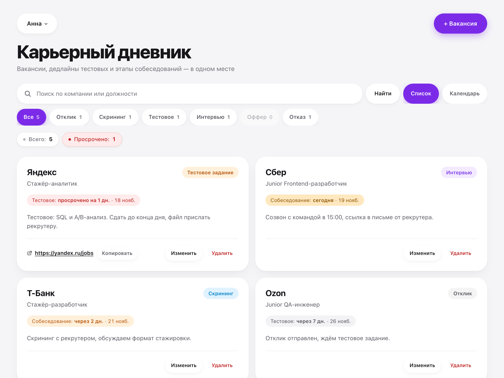
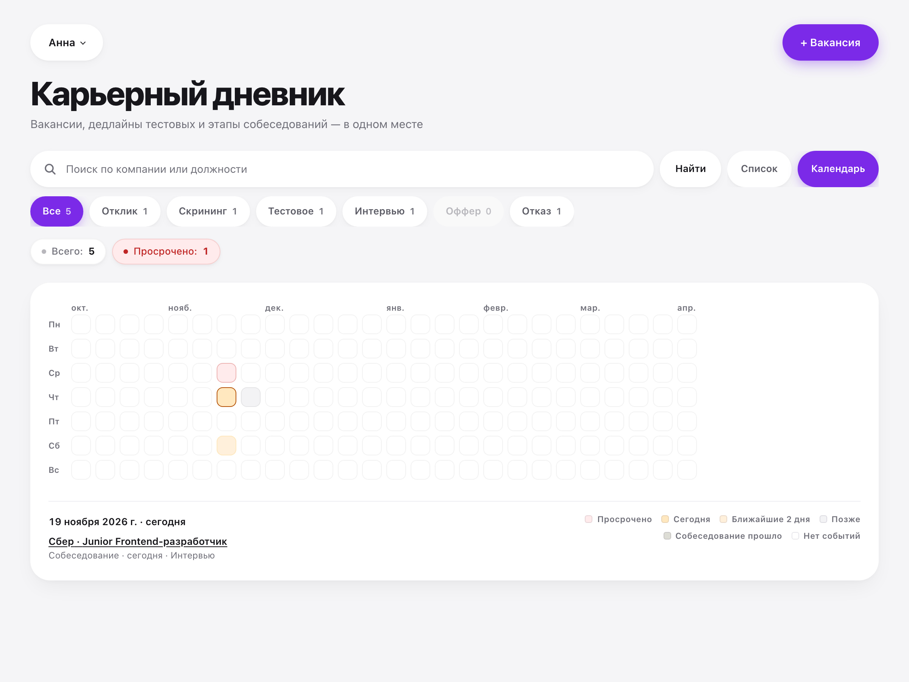
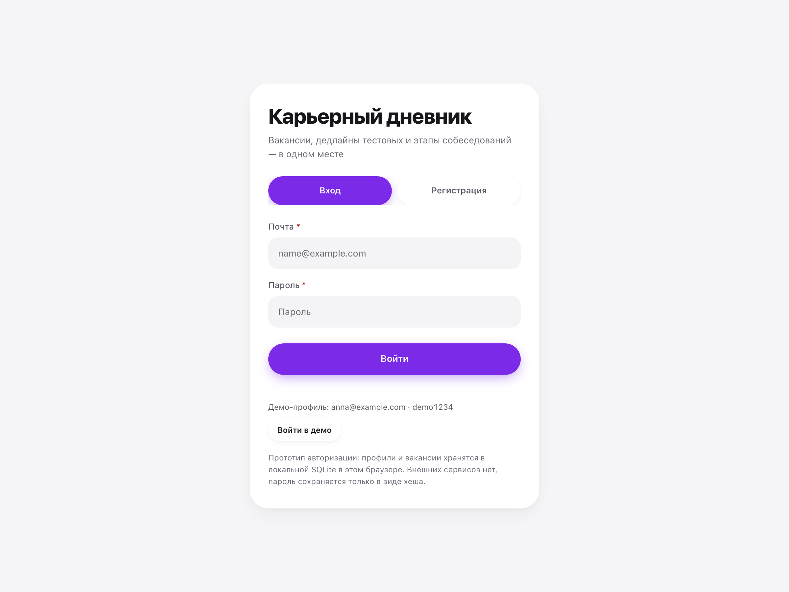
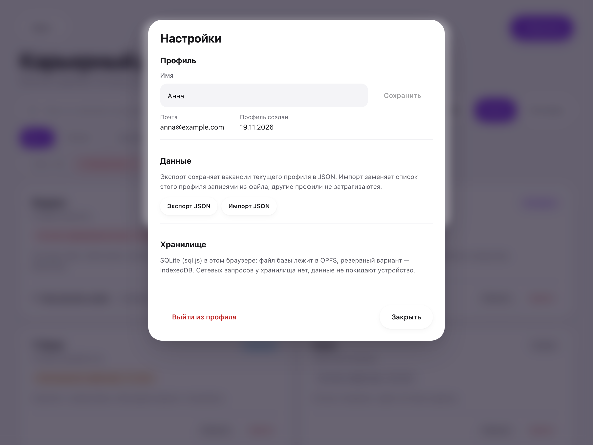
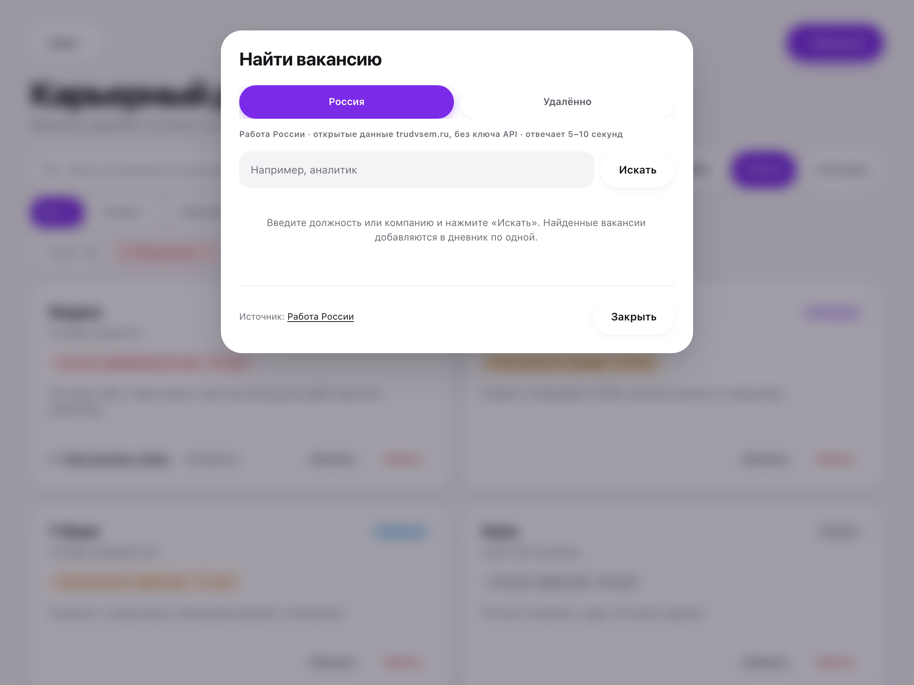
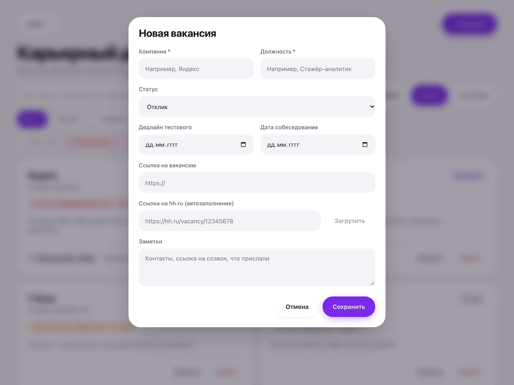
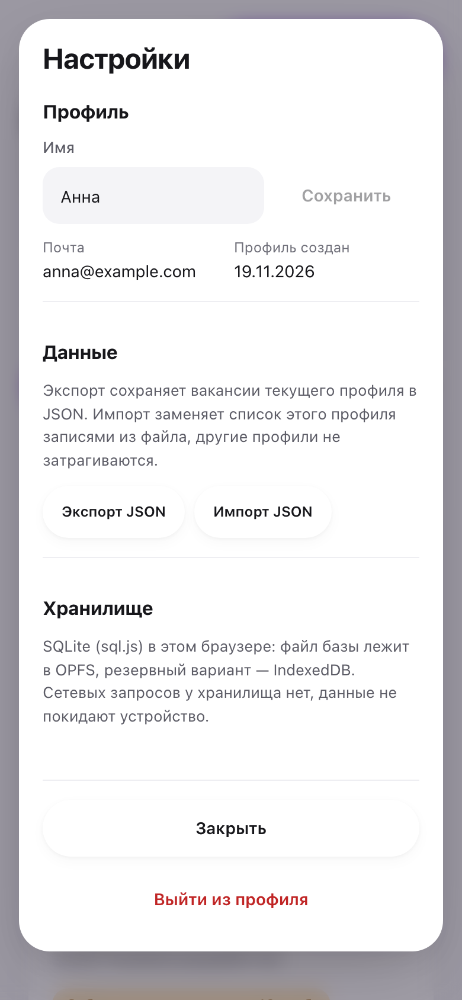

# Карьерный дневник

Приложение для учёта откликов: вакансии, дедлайны тестовых заданий и этапы собеседований в одном списке. Есть **вход в профиль**: у каждого пользователя свой список вакансий. Сервера нет — профили и данные лежат в **SQLite внутри браузера**, сеть нужна только для необязательных функций: автозаполнения по ссылке hh.ru и поиска вакансий во внешних каталогах.

**Итоговый проект по ИДЗ № 1.** React + Vite, JavaScript/JSX, без UI-библиотек и роутера.

## Скриншоты

Список вакансий — просроченный дедлайн сверху, относительные и календарные даты:



Календарь на полгода: цвет клетки — срочность дня, клик по событию ведёт к карточке:



Вход и регистрация — прототип авторизации с локальными профилями:



Настройки профиля: имя, экспорт и импорт данных, сведения о хранилище:



Поиск вакансий во внешних каталогах без ключа API:



Форма создания: поля, статус, даты, ссылки и блок автозаполнения с hh.ru:



Мобильная ширина 390 px — один столбец без горизонтального скролла:



## Что умеет

**Основной сценарий (по PRD)**

- Создание, редактирование и удаление вакансии в одной модальной форме; обязательные компания и должность, проверка ссылки.
- Шесть фиксированных статусов с цветными бейджами: Отклик, Скрининг, Тестовое задание, Интервью, Оффер, Отказ.
- Дедлайн тестового и дата собеседования с относительной подписью («сегодня», «через 3 дн.») и календарной датой рядом; просроченный дедлайн — красный, прошедшее собеседование — нейтральное.
- Сортировка: просроченные тестовые → ближайшие будущие даты → остальные по времени изменения.
- Поиск по компании и должности без учёта регистра и «ё», фильтр по статусу со счётчиками.
- Пустое состояние, «Загрузить примеры» (5 демо-вакансий), пустой результат фильтра со сбросом.
- Уведомления о действиях, подсветка изменённой карточки, подтверждение удаления и закрытия «грязной» формы.

**Дополнительно к итоговому проекту**

| Возможность | Что делает |
|---|---|
| **Профили и вход** | Регистрация и вход по почте и паролю; пароль хранится как соль + SHA-256, сессия переживает перезагрузку |
| **Изоляция данных** | У каждого профиля свой список вакансий; чужие записи не видны |
| **Настройки** | Смена имени, экспорт/импорт JSON, сведения о хранилище и выход — в отдельном окне |
| **SQLite в браузере** | Данные в настоящей базе (sql.js + OPFS), схема с индексами, а не JSON в `localStorage` |
| **Календарь-теплокарта** | Полгода по неделям: цвет клетки — срочность события, тултип и панель деталей дня, клавиатурная навигация |
| **Автозаполнение с hh.ru** | Ссылка на вакансию → компания, должность, описание и ссылка подставляются в форму |
| **Каталог вакансий** | Поиск в открытых данных «Работа России» и Remotive без ключа API, добавление найденного в дневник одним нажатием |
| **Отмена удаления** | Уведомление «Вакансия удалена» с кнопкой «Отменить» на 6 секунд |
| **Экспорт/импорт JSON** | Резервная копия и перенос данных профиля между браузерами (в настройках) |
| **Горячие клавиши** | `N` — новая вакансия, `/` — поиск, `1`–`6` — фильтр по статусу |
| **Копирование ссылки** | Кнопка рядом со ссылкой в карточке |

## Хранение данных: SQLite

`localStorage` хранит 5 МБ, не умеет индексы и транзакции, а данные легко потерять при очистке. Здесь используется **SQLite, скомпилированный в WebAssembly** (`sql.js`), а сам файл базы сохраняется в постоянное хранилище браузера.

**Порядок выбора хранилища**

1. **OPFS** (Origin Private File System) — файл `career-diary.sqlite`, переживает перезагрузку и очистку кэша.
2. **IndexedDB** — фоллбек, если OPFS недоступен.
3. **Память** — приложение работает, но честно предупреждает: «данные не сохранятся».

К вызовам хранилища добавлены таймауты: если браузер «подвесил» Storage API, приложение не застревает на экране загрузки, а деградирует до следующего уровня.

**Схема (версия 2)**

```sql
CREATE TABLE users (
  id            TEXT PRIMARY KEY,       -- UUID
  name          TEXT NOT NULL,
  email         TEXT NOT NULL UNIQUE COLLATE NOCASE,
  password_hash TEXT NOT NULL,          -- соль + SHA-256, 1000 итераций
  password_salt TEXT NOT NULL,
  created_at    TEXT NOT NULL
);

CREATE TABLE vacancies (
  id                TEXT PRIMARY KEY,   -- UUID
  user_id           TEXT REFERENCES users(id) ON DELETE CASCADE,
  company           TEXT NOT NULL,
  position          TEXT NOT NULL,
  status            TEXT NOT NULL DEFAULT 'applied',
  test_deadline     TEXT,               -- YYYY-MM-DD, локальная дата
  next_interview_at TEXT,               -- YYYY-MM-DD
  link              TEXT,
  notes             TEXT DEFAULT '',
  created_at        TEXT NOT NULL,      -- ISO 8601
  updated_at        TEXT NOT NULL
);

CREATE INDEX idx_vacancies_user          ON vacancies(user_id);
CREATE INDEX idx_vacancies_status        ON vacancies(status);
CREATE INDEX idx_vacancies_test_deadline ON vacancies(test_deadline);
CREATE INDEX idx_vacancies_next_interview ON vacancies(next_interview_at);
CREATE INDEX idx_vacancies_updated_at    ON vacancies(updated_at DESC);
```

Даты хранятся строками `YYYY-MM-DD` — это локальная календарная дата без времени, поэтому переход на летнее время и часовой пояс не сдвигают дедлайн.

**Авторизация.** Профили локальные: почта уникальна без учёта регистра, пароль нигде не хранится в открытом виде. Сессия — ключ `career-diary.session.v1` в `localStorage`, поэтому после перезагрузки страницы и повторного запуска приложения вход сохраняется. Демо-профиль: `anna@example.com` / `demo1234`.

**Миграция.** База версии 1 открывается и автоматически обновляется до версии 2: создаётся `users`, у `vacancies` появляется `user_id`, старые записи закрепляются за демо-профилем. Версия хранится в `PRAGMA user_version`.

В `src/lib/schema.sql` заготовлены (закомментированы) таблицы следующих версий: `tags`, `vacancy_tags`, `stage_history`, `attachments`.

## Автозаполнение с hh.ru

В форме есть поле «Ссылка на hh.ru» и кнопка «Загрузить». Приложение достаёт ID из ссылки (`hh.ru/vacancy/12345678`), запрашивает публичный эндпоинт `https://api.hh.ru/vacancies/{id}` и подставляет компанию, должность, описание и ссылку. Уже введённые значения не затираются: заполняются только пустые поля.

- Кэш на 5 минут — у hh.ru лимит 120 запросов в минуту.
- Ошибки объясняются по-человечески: `404` — «вакансия не найдена», `403` — «доступ ограничен по сети или региону, заполните поля вручную», `429` — «слишком много запросов».
- В dev-режиме при сетевой ошибке запрос повторяется через прокси Vite (`/api/hh`), в продакшене — напрямую (CORS у hh.ru открыт).
- **Важно:** hh.ru отвечает `403` из части сетей и регионов (DDoS-Guard), а авторизованные методы требуют приложения, которое создаётся только для работодателей — самостоятельной регистрации для частного лица нет. Поэтому функция необязательная: форма в этом случае просто просит заполнить поля вручную.

## Каталог вакансий (внешние данные без ключа)

Кнопка «Найти» в тулбаре (и «Найти в каталоге» в пустом состоянии) открывает окно поиска с двумя источниками открытых данных:

| Источник | Что даёт | Особенности |
|---|---|---|
| **Работа России** (`opendata.trudvsem.ru`) | вакансии РФ: компания, должность, регион, зарплата, занятость, обязанности | без ключа, CORS открыт; отвечает медленно (5–10 с), пагинация |
| **Remotive** (`remotive.com`) | удалённые вакансии | без ключа, CORS открыт; быстрый, англоязычный |

Найденную вакансию можно добавить в дневник: создаётся карточка со статусом «Отклик», ссылкой на первоисточник и заметками из описания. Дубликаты по ссылке помечаются «Уже в дневнике». Запросы идут только по кнопке, результаты кэшируются на 10 минут, при недоступности каталога показывается ошибка с «Повторить» — остальное приложение работает как обычно.

## Запуск

```bash
cd site
npm install
npm run dev      # http://localhost:5173 (если порт занят, Vite возьмёт следующий)
npm run build    # production-сборка в site/dist
npm run preview  # просмотр сборки

## Проверки

```bash
cd site && npm run build
```

Сборка проходит без ошибок и предупреждений: JS ~307 кБ (99 кБ gzip), CSS ~19 кБ, WASM 688 кБ (338 кБ gzip), 52 модуля.

Сценарии, прогнанные в браузере (headless Chrome через DevTools Protocol, реальные таймеры и настоящий SQLite):

1. **Пустое состояние** → «Пока ни одной вакансии», загрузка примеров даёт 5 карточек в порядке «просрочка → сегодня → +2 дня → +7 дней → без даты».
2. **Календарь** → 26 недель, 182 клетки, тона `overdue/today/soon/future` на своих датах, панель дня и клик по событию возвращают в список с подсветкой карточки.
3. **Форма** → пустая отправка показывает 2 ошибки и не закрывается; создание вакансии с дедлайном +2 дня даёт бейдж «через 2 дн. · 20 нояб.».
4. **Клавиатура** → `N` открывает форму, `Esc` закрывает, `1` включает фильтр «Отклик».
5. **Удаление** → подтверждение, карточка исчезает, «Отменить» возвращает её.
6. **Вход и профили** → регистрация, создание вакансии, перезагрузка: профиль и запись на месте; выход и повторный вход возвращают данные; второй профиль видит пустой список.
7. **Миграция** → база версии 1 с вакансией открывается, обновляется до версии 2, запись достаётся демо-профилю.
8. **Каталог** → «Россия» + «аналитик» даёт 1586 совпадений (видно регион и зарплату), «Удалённо» + `developer` отвечает меньше секунды; добавление создаёт карточку со ссылкой, повторный поиск показывает «Уже в дневнике», пустой запрос и «ыыыыы» дают «Ничего не найдено», блокировка сети — ошибку с «Повторить».
9. **hh.ru** → кривая ссылка даёт понятную ошибку, реальная — сообщение о блокировке 403 без падения формы.
10. **Мобильный 390 px** → горизонтального переполнения нет (`scrollWidth == clientWidth`).
11. Во всех сценариях — 0 исключений и 0 ошибок в консоли.

## Архитектура и структура данных

Подробное описание архитектуры, схемы сущностей, ER-диаграмма, последовательность сохранения данных и ограничения зафиксированы в [ARCHITECTURE.md](ARCHITECTURE.md).

Кратко:
- **База данных:** SQLite 3 в WebAssembly (`sql.js`).
- **Схема:** две связанные таблицы `users` (профили) и `vacancies` (вакансии) с внешним ключом `ON DELETE CASCADE` и индексами.
- **Хранение:** постоянное дисковое хранилище браузера **OPFS** (`career-diary.sqlite`) с автоматическим фоллбеком на **IndexedDB** и память.
- **Безопасность:** пароли хранятся исключительно в виде криптографической соли и хеша SHA-256 (Web Crypto API).

## Структура репозитория

```
ИДЗ1/
├── README.md
├── PRD.md                  # продукт: сценарии, функции, данные, проверки
├── ARCHITECTURE.md         # архитектура: схема БД, ER-диаграмма, жизненный цикл данных
├── DESIGN.md               # дизайн-система: токены, компоненты, состояния
├── spec.md                 # спецификация формата DESIGN.md
├── REFLECTION.md           # рефлексия: где помог ИИ, где мешал (требование сдачи)
├── AGENTS.md               # инструкции и регламент для AI-агента
├── reference.jpeg          # референс целевого визуального стиля
├── references/             # исходные дизайн-референсы (1_music, 2, 3_purple)
├── docs/                   # памятки курса и скриншоты интерфейса
│   └── images/             # актуальные превью интерфейса
├── scripts/
│   └── make-archive.sh     # чистый архив для сдачи (tar.gz и zip)
└── site/
    ├── index.html
    ├── package.json
    ├── vite.config.js      # React-плагин + прокси hh.ru
    └── src/
        ├── App.jsx
        ├── main.jsx
        ├── styles.css
        ├── components/     # карточка, форма, диалоги, тулбар, календарь,
                            # экран входа, настройки, поиск вакансий, бейджи
        ├── hooks/          # useAuth, useVacanciesSql
        └── lib/            # db, queries, schema.sql, auth, password, dates,
                            # heatmap, hhApi, jobsApi, statuses, sampleData,
                            # exportImport, storage
```

## Ограничения

Авторизация — прототип: нет восстановления и смены пароля, ограничения попыток входа и синхронизации между устройствами. При очистке данных браузера профили исчезают вместе с вакансиями. Уведомлений, календаря-планировщика и канбана нет — это осознанно вне рамок первой версии (см. [PRD §5](PRD.md#5-что-не-входит-в-первую-версию-итоговый-проект)).

Полная продуктовая логика — в [PRD.md](PRD.md), архитектура и структура данных — в [ARCHITECTURE.md](ARCHITECTURE.md), визуальная система — в [DESIGN.md](DESIGN.md), рефлексия по проекту — в [REFLECTION.md](REFLECTION.md).